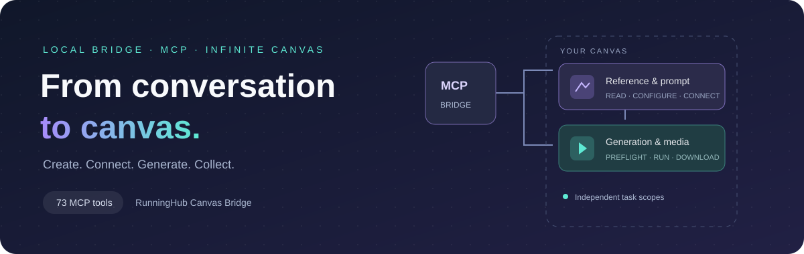

<div align="center">



# RunningHub Canvas Bridge

**让 AI 通过 MCP 操作 RunningHub 无限画布。**

发现画布 · 配置应用 · 绑定素材 · 提交生成 · 下载结果

[](https://github.com/limyum-creator/runninghub-canvas-bridge/releases)
[](docs/TOOLS.md)
[](https://github.com/limyum-creator/runninghub-canvas-bridge/actions)
[](LICENSE)

[**开始安装**](AGENT_INSTALL.md) · [**Agent 接入**](AGENT_QUICKSTART.md) · [**工具目录**](docs/TOOLS.md) · [**下载发布包**](https://github.com/limyum-creator/runninghub-canvas-bridge/releases/latest)

</div>

---

## 从对话到画布

把重复的开页、填参数、连参考、整理和下载交给 AI。桥接复用浏览器中已登录的 RunningHub 会话，让支持 MCP 的客户端直接操作画布，减少逐步点击和截图识别。

支持国际站 `www.runninghub.ai` / `rhtv.runninghub.ai`；保留中国站地址适配。可使用 **Codex 内置浏览器、Chrome 或 Edge**，通过本机 stdio MCP 接入，也可通过 Secure MCP Tunnel 接入 ChatGPT 个人插件。

| 制作准备 | 画布操作 | 结果管理 |
| :--- | :--- | :--- |
| 查询账号全部画布并自动打开 | 创建模型或原生 AI 应用节点 | 查询任务状态与生成历史 |
| 读取实时模型和应用参数 | 修改提示词、参数和素材绑定 | 独立下载图片、视频和音频 |
| 上传本机素材或接收聊天附件 | 分组、对齐、缩放与模板排版 | 保存、比较和恢复画布快照 |
| 提交前检查输入与参考 | 批量准备镜头和提交生成 | 复用工作流、素材及历史输出 |

### 内置浏览器也能接入

安装专用扩展后，**不需要外部 Chrome 提供画布连接**。打开画布和账号目录请求优先使用在线的内置浏览器，也可明确指定浏览器来源。仍需本机桥接服务运行。

### 多个对话，各自操作自己的画布

每个任务持有独立 `scopeId`；自动开页会固定到具体页面。其他对话选择另一张画布，不会改变当前任务的目标。页面刷新或连接失效后重新打开获取连接，同一画布的写入仍需遵守版本检查。

### 原生 AI 应用与普通模型都可配置

直接读取原生应用的输入字段，修改时长、比例、种子等参数，绑定图片、视频、音频或文本参考。应用节点使用专用预检和运行路径，不再要求普通模型节点的 `modelCode`。

### 下载不依赖归档软件

按节点或准确的历史任务下载结果，查看进度、校验文件、重试失败任务；服务器支持且存在校验标识时可续传。光栈（Lumen）自动归档为可选集成。

### 媒体处理与费用授权

截帧、图片裁剪/缩放/旋转可在浏览器内免费处理；视频剪裁、倍速、倒放与音频提取也可使用桥接电脑的 FFmpeg。Agent 会比较画布与本地能力的便利性和效果再选择路径，原素材保留。

涉及积分或费用未确认的原生视频处理、AI 重绘/扩图/超分/修复，先生成具体计划，经用户授权后执行一次。授权绑定输入和参数，超时不会自动重复提交。付费原生路径已经接入授权流程，但尚未进行真实扣费验收；详细用法见 [Agent 指南](AGENT_QUICKSTART.md#media-processing-and-spending-consent-010)。

## 快速开始

**准备：** Node.js 22+、ffmpeg/ffprobe，以及一个已登录 RunningHub 的受支持浏览器。

```sh
git clone https://github.com/limyum-creator/runninghub-canvas-bridge.git
cd runninghub-canvas-bridge
npm ci
npm run build
npm run release:package
npm start
```

然后加载浏览器扩展：

| 浏览器 | 选择的扩展目录 |
| --- | --- |
| Codex / 桌面应用内置浏览器 | `dist/runninghub-canvas-bridge-codex-extension` |
| Chrome / Edge | `extension` |

在浏览器扩展管理器选择“加载未打包的扩展程序”。内置浏览器的入口是 **设置 → 浏览器 → 扩展程序管理器 → 管理**。下载 ZIP 时先解压，再选择包含 `manifest.json` 的目录。

将 `server/mcp.mjs` 配置为客户端的 stdio MCP 入口，即可开始。**完整配置、Windows 命令、后台服务与 ChatGPT 插件接入见 [安装说明](AGENT_INSTALL.md)。** 默认启动不启用生成；需要生成时按安装说明设置 `RH_BRIDGE_ALLOW_GENERATION=1`。

## 自动更新

正式安装包可开启自动更新：`node scripts/rh-update.mjs enable`。Windows / macOS 每六小时检查正式 Release，空闲时更新桥接、MCP、页面运行时和已登记扩展；保留配置与 OAuth 授权，失败回退程序。源码开发目录不会被覆盖。

首次装入本版后需重新加载一次旧扩展，后续已登记扩展可自行检测更新并重载。客户端可能需要刷新工具列表；普通更新不需要重新授权账号。详见 [自动更新与恢复](docs/AUTO_UPDATE.md)。

## 一次典型调用

```text
rh_list_canvases               查询账号目录
        ↓
rh_open_canvas                静默复用目标连接，取得独立 scopeId
        ↓
rh_get_layout_template        读取持久排版规范
        ↓
rh_canvas_summary / get_node  检查已有内容
        ↓
配置节点 → 绑定素材 → preflight → run_node
        ↓
查询任务 → 下载结果 → 可选归档
```

后续画布调用都携带自己的 `scopeId`。需要修改时打开连接须设置 `allowWrites: true`；生成使用独立的稳定 `requestId`。超时先查询原回执，不盲目重发。

## 能力与验证边界

| 项目 | 当前情况 |
| --- | --- |
| 节点历史 | 原生历史读取、按真实任务修复索引；生成完成后自动同步，断线与重启后续接 |
| 工具 | 82 个 MCP 工具，覆盖连接、编辑、媒体、任务、布局及恢复 |
| macOS 现场验证 | 内置浏览器目录、独立页面读写、应用配置与预检、聊天附件上传、视频下载、工作流及快照恢复 |
| 自动测试 | 本地 108 项通过；2 项 Windows 专用检查在 macOS 跳过；Windows 相关测试 51 项通过。完整跨平台结果以 Actions 为准 |
| 免费媒体处理 | 已实测浏览器截帧、图片裁剪、保存回读，以及本地 FFmpeg 处理；付费路径已验证未授权时拒绝提交 |
| Windows | 已实测后台服务、浏览器目录与画布读取、公网 OAuth、刷新授权和进程恢复 |
| 远程 HTTP 接口 | 公网 OAuth 已验证（0.9.1 的 73 工具）；Gemini 英文界面、Grok Bot 均已实测状态、布局模板、目录、画布连接与摘要，支持中文指令 |
| 生成与取消 | 已实现；本轮验证了应用生成预检和请求预览，未额外提交付费生成或现场取消任务 |
| 预览 | 返回媒体资源链接；客户端是否内联播放取决于宿主支持 |
| 中国站 | 保留地址与协议适配；本版现场验收以国际站为主 |

实时模型、登录状态、平台接口和账号权益会影响可用性。详见 [验证说明](docs/international-validation.md)。

## 文档导航

| 文档 | 内容 |
| --- | --- |
| [安装说明](AGENT_INSTALL.md) | 浏览器扩展、本机 MCP、后台服务、ChatGPT 插件、升级 |
| [Agent 快速上手](AGENT_QUICKSTART.md) | 任务连接、应用参数、媒体、下载、冲突与恢复 |
| [远程 MCP 接入](docs/REMOTE_MCP.md) | Gemini、Grok Bot 等远程客户端的 HTTPS 网关、OAuth 与域名配置 |
| [82 个工具](docs/TOOLS.md) | 按能力分组的完整工具目录；准确参数以工具 schema 为准 |
| [自动更新](docs/AUTO_UPDATE.md) | 开启、暂停、保留授权、空闲切换与失败恢复 |
| [更新记录](CHANGELOG.md) | 版本变化与兼容性调整 |
| [贡献指南](CONTRIBUTING.md) | 开发和反馈 |

<details>
<summary><strong>开发与打包</strong></summary>

```sh
npm run check
npm test
npm run build
npm run release:package
npm pack --pack-destination dist
```

`dist/` 包含普通扩展、内置浏览器专用扩展及校验文件。源码包包含本地运行所需模块。登录凭据留在网页内；私有安装笔记、任务回执和项目素材不应提交到仓库。

</details>

## 参考

本仓库为独立实现。连接 RunningHub 画布的思路，参考了 [windzu/runninghub-canvas-bridge](https://github.com/windzu/runninghub-canvas-bridge)。
