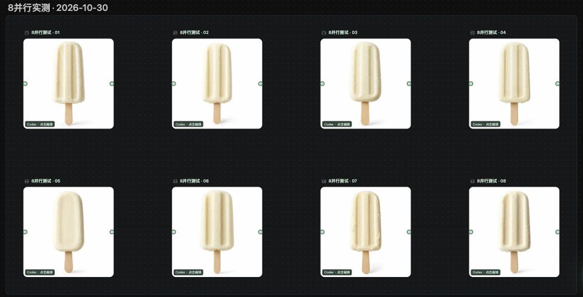

# 8 并行生图实测 · 2026-10-30

沿用本机已登录的 Codex 账户，在 RunningHub 原生画布中创建 8 个独立 Codex 图片节点，每个节点生成 1 张方形雪糕产品图。全局并行设为“不限”，本轮严格只提交 8 张，每张仅尝试一次，`autoRetryLimit: 0`；未重试或继续升档。

| 指标 | 实测结果 |
| --- | --- |
| 提交、成功保存 | 8 / 8 |
| 原生生图工具阶段重叠峰值 | 8 |
| 全部 8 个任务共同绘图 | 14.991 秒 |
| 提交至全部生成并保存 | 65.992 秒 |
| 单张绘图耗时 | 19.365–30.246 秒 |
| 单张上传与保存耗时 | 5.856–9.579 秒 |
| 失败、429、自动重试 | 0、0、0 |
| 实际尺寸 | 全部 1254 × 1254 |
| 图片与节点回读 | 8 张完整解码，8 个独立哈希均与各自节点历史一致 |
| 画布布局 | 四列两行，布局检查通过，既有节点版本未变 |

重叠数根据原生 `imageGeneration` 工具的开始与完成事件计算；只观察本机任务“运行中”状态不足以证明绘图重叠。这些事件也不能揭示上游 GPU 的内部调度。总耗时包括准备、原生绘图和上传保存，不能只用单张绘图时间替代。

本次证据支持“当前账户、网络和服务条件下，至少可同时运行 8 个生图任务，并全部成功写回画布”。8 是本轮测试档位，不是官方账户上限；更高并行、长时间持续负载与其他账户尚未测试。“不限”只取消本机调度上限，上游仍可能限流或拒绝请求。

下图是完成后的真实画布局部截图，仅保留演示分组；它展示结果，过程重叠由上述事件测量。截图不含地址栏、账户信息、画布 ID、任务 ID 或私人分镜。原始图片、逐条回执和本机账户状态不随源码发布。

[安装与使用](CODEX_IMAGE_SETUP.md) · [返回界面演示](../README.md#界面演示)
